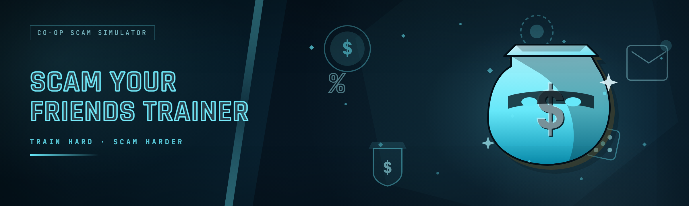

  
  
  

  

  
  

---

**The 2026 rewrite of a dead trainer project — rebuilt from scratch, tuned for the current game build, and actually maintained. No more "file not found" on launch day.**

---

## 🧭 Compatibility matrix (read this first)

Before you touch anything, find your row. This is the single most common reason people bounce off a trainer like this — the build version in the corner of your game menu has to line up with the offset set baked into the `.exe`.

| OS | Game platform | Game build | Status | Notes |
|---|---|---|---|---|
| Windows 11 23H2+ | Steam | Latest 2026 patch | ✅ Supported | Primary test rig |
| Windows 11 22H2 | Steam | Latest 2026 patch | ✅ Supported | Confirmed on clean VM |
| Windows 10 21H2+ | Steam | Latest 2026 patch | ✅ Supported | Needs admin for attach |
| Windows 10 20H2 | Steam | Latest 2026 patch | ⚠️ Partial | Overlay may flicker on attach |
| Windows 11 | Epic | Latest 2026 patch | ✅ Supported | Different memory layout handled |
| Windows 10/11 | Cracked / offline | Any | ❌ Not supported | No ships with those offsets |
| Windows 8.1 and older | Any | Any | ❌ Not supported | .NET runtime mismatch |
| Linux / macOS via Proton | Steam | Any | ❌ Not supported | Windows API calls in the injector |

If your row says ❌, stop here — the .exe will open and then close itself when it fails to find the process signature. That's intentional, not a bug.

---

## 📌 Overview

| Category | Details |
|---|---|
| Project name | Scam With Your Friends Trainer |
| Release year | 2026 |
| Distribution | Standalone `.exe`, portable, no installer |
| Runtime | .NET 8 desktop runtime (bundled) |
| Attach method | External process attach + pattern scan |
| Config format | Plain JSON next to the `.exe` |
| Update cadence | Offset refresh after each game patch |
| Original project | Abandoned 2022, taken over and rewritten |
| Language | English UI, English docs |

Scam With Your Friends Trainer started life as a half-finished hobby repo that hadn't been touched since 2022 — the offsets were stale, the UI was a single WinForms window with three checkboxes, and the loader crashed on any game build newer than the one it was written for. This is the 2026 rewrite: same idea (mess around with your friends in a private lobby), completely new codebase, proper pattern scanning instead of hardcoded addresses, and a config system that doesn't reset every launch.

The whole thing is a single portable `.exe`. No installer, no registry keys, no background service. Extract it to a folder, run it, point it at the game, toggle what you want, close it when you're done.

  

---

## 🎯 What is Scam With Your Friends Trainer?

Glossary for people who found this repo through a search and aren't sure what half the words mean:

| Term | Explanation |
|---|---|
| **Trainer** | A standalone program that reads and writes values in another running game's memory to change its behavior. Not a mod, not a plugin — it sits outside the game. |
| **Attach** | The moment the trainer opens a handle to the game process so it can read/write memory. Everything before this point is just a UI. |
| **Offset** | The memory address (relative to the game's base) where a specific value lives. Offsets change every game patch, which is why old trainers break. |
| **Pattern scan** | Instead of hardcoding an offset, the trainer searches for a byte signature near the value it wants. Survives minor patches. |
| **Godmode / infinite** | A toggle that continuously rewrites a value (health, ammo, stamina) so it never drops. Named after the classic cheat-code term. |
| **Teleport** | Writing your position coordinates directly to a saved waypoint. Breaks physics if you do it wrong — see the FAQ. |
| **Lobby tool** | A feature that changes lobby settings (money, round count, difficulty) that the host normally can't reach through the in-game menu. |

Why people actually use it:

- You want to mess around with friends in a **private lobby** without grinding for resources first.
- You're testing a build/strategy and want to skip the setup phase.
- You want to spawn things the game normally gates behind progression, just to see what happens.
- You're a modder poking at the game's memory layout and want a readable UI instead of Cheat Engine tables.
- You want a trainer that doesn't die the day after a patch drops.

---

## 🧩 Key Features

| Feature | Description | Benefit |
|---|---|---|
| Pattern-based attach | Finds the game via signature scan, not a fixed offset | Survives most minor patches |
| Portable `.exe` | No install, no registry, no service | Run from a USB stick if you want |
| JSON config | Settings saved next to the `.exe` | Your toggles persist across launches |
| Hotkey system | Every toggle can be bound to a key | No alt-tabbing mid-game |
| Attach guard | Refuses to attach to unsupported builds | No corrupting your save |
| Overlay HUD | Small in-game status readout | See active toggles without leaving the game |
| Waypoint teleport | Save and recall up to 8 positions | Skip backtracking |
| Lobby controls | Host-side round/money/difficulty tweaks | Set up the session you actually want |
| Value freeze | Pin any scanned value at a number you choose | "Infinite" anything, not just health |
| Crash-safe detach | Cleanly detaches on game exit | No orphaned handles |
| Log file | Rotating text log next to the `.exe` | Diagnose why an attach failed |
| Update checker | Checks a text file for the latest offset set | Tells you when to re-download |

---

## ⚔️ Feature modules — combat & survivability

Numbered so you can point at one in a bug report. Each is a toggle in the **Combat** tab.

1. **Godmode** — Freezes your health value at the current max. Does not prevent one-shot kills from scripted events (see Known Issues).
2. **Infinite stamina** — Pins the stamina pool so sprint/dodge never drains. Cosmetic in most modes; genuinely useful in the parkour sections.
3. **Infinite ammo** — Rewrites the magazine counter every tick. Does not touch reserve ammo by default — that's a separate toggle.
4. **No reload** — Skips the reload animation entirely by forcing the chambered count back to full. Can desync the animation state on some weapons.
5. **Damage multiplier** — Slider from 1× to 50×. Applies to your outgoing damage only.
6. **One-hit stagger** — Forces the stagger threshold to trigger on every hit. Fun against heavies, useless against bosses with stagger immunity.
7. **No recoil** — Zeroes the recoil impulse value after each shot. Purely visual for the shooter; server-side recoil is unchanged.
8. **Rapid fire** — Cuts the fire-rate cooldown. Some weapons have a hardcoded cap the trainer can't reach.

> **Ammo note:** the freeze is a write-per-tick operation. On very high fire-rate weapons combined with a low tick rate, the counter can visually flicker. The actual value is correct; the UI just reads it a frame late.

---

## 🎒 Feature modules — inventory & economy

Everything here is **host-authoritative** — if you're a client in someone else's lobby, these toggles will appear to work and then snap back. That's not a bug, that's how the game syncs inventory.

9. **Money set** — Type a number, hit apply, the host's wallet updates. Values above the game's internal cap get clamped.
10. **Item spawner** — Spawns by internal item ID. There's a searchable list in the UI; the list is generated from the current game build.
11. **Instant unlock** — Marks progression-gated items as unlocked for the current session. Not permanent — resets on save load.
12. **No durability loss** — Freezes durability at max. Works on tools and gear; doesn't touch quest items.
13. **Weight override** — Sets the carry-weight penalty to zero. The inventory cap itself stays, but nothing gets slow.
14. **Fast crafting** — Forces the craft timer to zero. The materials are still consumed.
15. **Loot table preview** — Read-only overlay that shows what the current container rolled. Useful for testing.

---

## 🗺️ Feature modules — movement & world

16. **Teleport to waypoint** — Jump to any of your 8 saved positions. Saves the position you were standing at when you hit the save key.
17. **Save position** — Binds the current coordinates to a slot. Overwrites silently.
18. **Noclip** — Disables collision for the player capsule. You will fall through the world if you hold it over an unloaded chunk — see FAQ.
19. **Speed multiplier** — 1× to 5×. Above 3× the character model animation breaks visibly but position is fine.
20. **Jump height** — Multiplies the launch impulse. Anything above 4× will clip you through low ceilings.
21. **Freeze position** — Locks the player in place. Useful for taking screenshots or testing. Not a substitute for pausing.
22. **Time scale** — Slows or speeds the world clock. Affects day/night cycles, not combat.
23. **No fall damage** — Zeroes the fall-damage calculation. Does not prevent the fall itself, so you can still get stuck.

---

## 🏠 Feature modules — lobby & session

These only do anything if **you are the host**. The trainer detects host status on attach and greys out the tab otherwise.

24. **Round count** — Sets the number of rounds for the session. Applied at next round start.
25. **Difficulty override** — Forces the difficulty tier regardless of what the menu says. Some achievements check the real tier, not this override.
26. **Party size unlock** — Raises the lobby cap above the default. Everyone joining still needs the same game build.
27. **Money pool** — Sets the shared lobby money. Different from the personal wallet toggle.
28. **Kick protection** — Prevents the game's auto-kick for idle players on the host's own client.
29. **Session timer freeze** — Stops the lobby countdown. Use this if you're the one waiting on a friend.
30. **Map vote override** — Forces the next map. Cosmetic in most modes.
31. **Spawn wave editor** — Adjusts how many enemies spawn per wave. Values above ~3× will tank your framerate.

---

## 🛠️ Feature modules — UI, config & tooling

32. **Overlay HUD** — A small always-on-top readout of active toggles. Toggle it off if it bothers you.
33. **Hotkey binder** — Click a toggle, press a key, done. Conflicts are highlighted in red.
34. **Config profiles** — Save multiple JSON profiles and switch between them. Handy for "testing" vs "goofing off" setups.
35. **Value scanner** — A mini Cheat Engine: scan for a numeric value, narrow it down by rescanning, then freeze or edit. The beginner-safe way to find something the trainer doesn't expose yet.
36. **Diagnostic dump** — Writes the current game build ID, module base, and detected offsets to the log. Paste this when reporting a bug.

---

## 🧱 The Problem — why the old trainer was unusable

- **Offsets went stale after every patch.** The 2022 build had hardcoded addresses. One game update and every toggle silently did nothing.
- **The loader crashed on newer game builds.** It validated the build ID against a list that stopped being updated.
- **No config persistence.** Every launch reset you to zero toggles, so you re-ticked the same six boxes every session.
- **One giant "attach" button with no feedback.** You never knew if it worked until you checked in-game.
- **No host detection.** Lobby toggles were visible to clients and just did nothing, which looked like a bug.
- **Single-window UI from 2019.** Three checkboxes, no hotkeys, no log, no way to figure out why something failed.
- **Abandoned.** Issues piled up, the maintainer stopped responding, and forks drifted apart.

---

## 🧪 The Solution — what the rewrite changed

| Problem | Solution |
|---|---|
| Offsets went stale after every patch | Signature-based pattern scanning with a fallback offset table — minor patches just work, major ones need an offset refresh |
| Loader crashed on newer builds | Attach guard validates the build *after* attaching, then detaches cleanly instead of crashing |
| No config persistence | JSON config written next to the `.exe` on every change, loaded on launch |
| Silent attach failures | Log file + on-screen status line + diagnostic dump button |
| Lobby toggles visible to clients | Host detection greys out the whole tab when you're not the host |
| Outdated UI | Tabbed layout, hotkey binder, searchable lists, per-toggle tooltips |
| Unmaintained | Active 2026 release, offset sets published after each game patch |

---

## 🚀 Quick start

1. 🧾 **Check the compatibility matrix** above. If your row is ❌, don't continue — it won't work and it's not supposed to.
2. ⬇️ **Download the `.exe`** from the project page. It's a single portable file — no installer, no companion DLLs.
3. 📁 **Extract to a normal folder** like `Desktop\swft\` or `C:\Tools\swft\`. Avoid `Program Files` — Windows will block memory writes from there without extra steps.
4. ▶️ **Run the `.exe`** (right-click → Run as administrator on Windows 10; Windows 11 usually prompts automatically).
5. 🎮 **Launch the game** and get to the main menu, then alt-tab to the trainer and hit **Attach**.
6. ✅ **Watch the status line** — green means the pattern scan found the target module and the build is supported.
7. 🎛️ **Toggle what you want** in the tabs, bind hotkeys if you like, then close the trainer's main window (the overlay stays if you left it on).

> **Edge case:** if Attach says "process found, build unsupported", your game is on a build the 2026 offset set doesn't cover yet. Check the repo's releases for a fresh offset pack, or run the **Diagnostic dump** and post it in issues.

---

## 🧰 System Requirements

| Component | Minimum | Recommended |
|---|---|---|
| OS | Windows 10 21H2 (64-bit) | Windows 11 23H2+ |
| CPU | Dual-core 2.0 GHz | Quad-core 3.0 GHz+ |
| RAM | 4 GB | 8 GB+ |
| Disk | 60 MB free | 200 MB free (logs + profiles) |
| Runtime | Bundled .NET 8 | Bundled .NET 8 |
| Privileges | Administrator (required for attach) | Administrator |
| GPU | Anything that runs the game | Same as the game |
| Antivirus | Allow-list the `.exe` folder | Same |

---

## ⚙️ Installation

1. **Grab the `.exe`.** It's a single file. There is no zip, no setup wizard, no dependencies to install separately — the .NET runtime is bundled inside.
2. **Put it somewhere writable.** The trainer writes `config.json` and `trainer.log` next to itself. If the folder is read-only (Program Files, some synced folders), it'll fail to save settings and tell you in the log.
3. **First run.** Windows SmartScreen will likely flag it because it's an unsigned hobby binary. Click "More info" → "Run anyway" if you trust the source (you downloaded it from the project page). If you don't trust it, don't run it — that's the correct response to any unsigned trainer.

---

## 📊 Module status

| Module | Status | Description |
|---|---|---|
| Combat toggles | ✅ Working | Godmode, stamina, ammo, damage, stagger, recoil, fire rate |
| Inventory & economy | ✅ Working | Money set, spawner, unlock, durability, weight, crafting |
| Movement & world | ✅ Working | Teleport, noclip, speed, jump, freeze, time scale, fall damage |
| Lobby & session (host) | ✅ Working | Round count, difficulty, party size, money pool, map vote, waves |
| UI & tooling | ✅ Working | Overlay, hotkeys, profiles, value scanner, diagnostic dump |
| Overlay HUD | ⚠️ Partial | Flickers on Windows 10 20H2 with fullscreen exclusive |
| Value scanner | ⚠️ Partial | Can't scan float values below 0.01 reliably |
| Epic Games build | ✅ Working | Separate offset set, auto-detected |
| Cracked/offline builds | ❌ Not supported | No offsets shipped, attach will refuse |

---

## 🩺 Troubleshooting flow

If something doesn't work, walk this in order — it catches ~90% of reports:

1. **Attach does nothing** → Run as administrator. The trainer needs a handle with write access.
2. **Attach says "build unsupported"** → Your game patched. Download the latest offset pack from releases.
3. **Attach works, toggles do nothing** → You're a client in someone else's lobby, not the host. Lobby tab is greyed out for a reason.
4. **Toggles work but reset after a minute** → The game re-synced from the host. Expected for client-side economy toggles.
5. **Game crashes on attach** → Check the log. If it's an access violation, post the diagnostic dump in issues with your build ID.
6. **Overlay is a black rectangle** → You're in fullscreen exclusive. Switch the game to borderless windowed.
7. **SmartScreen blocks the `.exe`** → Expected for unsigned binaries. "More info" → "Run anyway", or don't run it.

---

## ⚠️ Known Issues

| Issue | Solution |
|---|---|
| Godmode doesn't stop scripted one-shot kills | By design — those bypass the health value entirely. No fix planned. |
| Noclip drops you through unloaded chunks | Hold still for a second after toggling so the chunk streams in first. |
| Speed above 3× breaks character animation | Cosmetic only, position is correct. Keep it at 3× or below for normal play. |
| Overlay flickers on Win10 20H2 fullscreen exclusive | Use borderless windowed, or update to a newer Windows build. |
| Value scanner misses very small floats | Known limitation of the current scanner precision. Use exact-value scan with a wider tolerance. |
| Config resets if the `.exe` folder is read-only | Move the `.exe` to a writable folder. |
| Party size unlock doesn't let clients join | Everyone in the lobby must be on the same game build. Enforce that before blaming the trainer. |

---

## ❓ FAQ

1. **Will this get me banned?**
   It modifies game memory, which is against most games' terms of service. In a private lobby with friends who know what's happening, the practical risk is low. In public matchmaking, it's high. The trainer has no anti-cheat evasion built in — if the game's anti-cheat is active, don't use it. The honest answer: use it in private sessions, accept the risk in public ones.

2. **Is it safe to run?**
   It's an unsigned hobby binary, which means Windows will warn you and you have no third-party proof it's clean. It doesn't phone home, doesn't install anything, and the source is in this repo. If you're not comfortable running unsigned `.exe` files, don't — that's a reasonable position.

3. **Does it work on Steam and Epic?**
   Yes, both, with separate offset sets that the trainer auto-detects on attach. The compatibility matrix up top lists the exact builds.

4. **Why does the `.exe` need administrator rights?**
   Attaching to another process and writing to its memory requires it. There's no way around that on Windows — any tool that claims otherwise is lying or broken.

5. **Why does it say "build unsupported" after a game patch?**
   Because the pattern scan needs to be re-validated against the new build. Offset packs are published after each game patch; grab the latest one and drop it next to the `.exe`.

6. **Can I use it in public lobbies?**
   You can, and it'll probably work, but that's exactly the scenario where bans happen and where you're ruining someone else's session. The trainer is built for private lobbies with friends. Don't be the guy in public matchmaking.

7. **Why did the old version stop working?**
   It used hardcoded offsets from 2022. The rewrite uses pattern scanning, which survives most minor patches. Major patches still need an offset refresh.

8. **Do I need to install anything else?**
   No. The .NET runtime is bundled in the `.exe`. No pip, no npm, no DLLs to drop anywhere.

9. **Where are my settings saved?**
   `config.json` next to the `.exe`. Profiles live in a `profiles/` subfolder. The log is `trainer.log` in the same place.

10. **Can I get the source?**
    Yes — this is the source repo. The `.exe` on the project page is a build of what's in `main`. Build instructions are in `BUILDING.md` if you want to compile it yourself.

---

## 🗓️ Roadmap — planned features

| Feature | Status | ETA |
|---|---|---|
| Offset auto-updater (in-app download) | 🧪 In progress | Next minor release |
| Linux/Proton support via Wine shim | 💭 Exploring | Unscheduled |
| Steam Deck test pass | 💭 Exploring | Unscheduled |
| Per-weapon recoil profiles | 📝 Planned | Next major |
| Scripting API for custom toggles | 📝 Planned | Next major |
| Value scanner float precision fix | 🐞 Tracked | Next patch |
| Overlay rewrite (no flicker on Win10) | 🐞 Tracked | Next patch |
| Achievement-safe mode (disables toggles that block achievements) | 📝 Planned | Unscheduled |
| Localization (DE/FR/ES) | 💭 Exploring | Unscheduled |

---

## 🧷 Usage guidelines

| Allowed | Not allowed |
|---|---|
| Private lobbies with friends who know you're using it | Public matchmaking / ranked |
| Single-player or offline sessions | Selling the trainer or bundling it in paid products |
| Testing builds and strategies in your own session | Harassing players who didn't opt in |
| Modding/learning how memory reading works | Claiming it's undetectable or ban-proof |
| Sharing your `config.json` profiles | Reuploading the `.exe` with added malware |
| Hosting a lobby with friends and enabling host toggles | Using it to ruin someone else's stream or session |

---

## 🧾 Closing

The 2026 rewrite exists because the original project was left in a state where it silently did nothing after every patch, and nobody wanted to maintain it. This build fixes the maintenance problem first — pattern scanning, offset packs, a real log — and the feature set second. If you find a build where a toggle silently fails, the diagnostic dump in the tooling tab is the fastest way to get it fixed. Use it in private lobbies, respect the people you're playing with, and read the compatibility matrix before you file an issue.

  

---

